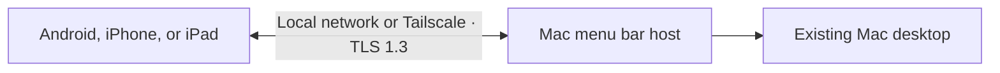

<p align="center">
  
</p>

<h1 align="center">Tetherly</h1>
<p align="center"><strong>Your Mac, a little closer.</strong><br>View and control your Mac from your phone or tablet, on Wi-Fi or through Tailscale.</p>
<p align="center">
  <a href="docs/README.md">Documentation</a> ·
  <a href="docs/GETTING_STARTED.md">Get started</a> ·
  <a href="CONTRIBUTING.md">Contribute</a> ·
  <a href="https://tetherly.link">Website</a>
</p>

---

Tetherly brings your existing Mac desktop to Android, iPhone, and iPad. Open an app, move the pointer, type a shortcut, or send a document while your Mac stays where it is. The host is a native Swift menu bar app; the clients use Kotlin/Compose and SwiftUI.

No Tetherly account is required. Tetherly has no advertising or account. Android QR scanning uses Google Play services, which collects diagnostics as described in the [privacy policy](https://www.tetherly.link/privacy). Your devices pair with a code you compare on both screens, then connect using mutually authenticated TLS 1.3. Tetherly runs no relay service. For connections across networks, Tailscale is a separate service with its own account and infrastructure.

> **Version 0.1.0.** [Mac and Android downloads](https://www.tetherly.link/#download) are available. iPhone and iPad store releases are coming soon. You can also build from source. Some paths have real-device evidence; others still need acceptance checks. Read the [current status](docs/PLAN.md) and [recorded evidence](docs/ACCEPTANCE.md) before relying on a development build.

## What you can do

| Capability | What it means |
| --- | --- |
| See your desktop | Stream the Mac's existing session as H.264 video. |
| Point and click | Switch between direct touch and trackpad input; scroll, drag, and zoom the local view. |
| Type and use shortcuts | Send text, modifier keys, function keys, and keyboard shortcuts. |
| Move clipboard text | Send or fetch text when you choose. |
| Send selected files | Transfer in either direction with receiver-selected destinations and hash verification. |
| Hear your Mac | Play Mac audio through the client. |
| Stay connected | Use local discovery, manual addresses, or routes learned from your Mac, including Tailscale. |

These capabilities are implemented in the source. Verification varies by platform and feature; the acceptance record distinguishes automated checks, Simulator runs, and physical-device checks. Clipboard, file transfers, audio, and remote sessions need broader device validation before release.

## Choose your starting point

| You want to… | Start here |
| --- | --- |
| Try Tetherly from source | [First connection](docs/GETTING_STARTED.md) |
| Connect on Wi-Fi or away from home | [Connection guide](docs/CONNECTIONS.md) |
| Build a native app or the website | [Development](docs/DEVELOPMENT.md) |
| Understand the code | [Architecture](docs/ARCHITECTURE.md) |
| Fix a connection or permission problem | [Troubleshooting](docs/TROUBLESHOOTING.md) |
| Help the project | [Contributing](CONTRIBUTING.md) |

## A first build

Clone your fork or this repository, then run commands from its root:

```sh
git clone https://github.com/datahase/tetherly.git
cd tetherly
./scripts/doctor.sh
```

The native toolchain uses Xcode 27, JDK 17+, and Android SDK platform 36. You only need the tools for the component you work on. The doctor checks all native toolchains, so a missing Android SDK does not prevent website work.

```sh
# Mac host
./scripts/build-macos.sh
open apps/macos/build/DerivedData/Build/Products/Debug/Tetherly.app

# Android client: unit checks and debug APK
./scripts/build-android.sh
```

For iPhone/iPad, open `apps/ios/TetherlyiOS.xcodeproj` in Xcode and select the `TetherlyiOS` scheme. A physical device needs your own signing team. See [development setup](docs/DEVELOPMENT.md) for signing, device installation, and all checks.

For website-only work:

```sh
cd apps/web
pnpm install --frozen-lockfile
pnpm dev
```

The website package pins pnpm in `package.json`; local builds and production use Node.js 24 LTS. The preview opens at `http://localhost:3000`.

## How a connection works



You explicitly open pairing on the Mac, compare the short codes, and approve the device. Subsequent sessions check the stored identities. Screen Recording permits capture; Accessibility permits input. Clipboard and files move through explicit actions.

Tetherly currently supports **macOS 14+**, **Android 12+**, and **iOS/iPadOS 17+**. Windows/Linux hosts, remote filesystem browsing, folder sync, and waking a sleeping Mac are outside the current scope.

## Inside the repository

| Directory | Purpose |
| --- | --- |
| [`apps/macos`](apps/macos) | Swift menu bar host and shared Swift protocol core |
| [`apps/android`](apps/android) | Kotlin/Compose client and JVM checks |
| [`apps/ios`](apps/ios) | SwiftUI iPhone/iPad client |
| [`apps/web`](apps/web) | Next.js website and setup guide |
| [`protocol`](protocol) | Wire contract and generated cross-platform fixtures |
| [`scripts`](scripts) | Toolchain checks, builds, installation, and asset/fixture generation |
| [`docs`](docs/README.md) | User guides, architecture, security, status, and release preparation |

## Build it with us

A useful contribution can be a clearer setup step, a reproducible device report, an accessibility improvement, a bug fix, or a protocol review. Start small and describe what you observed. For larger changes, open an issue to discuss the approach before implementation.

Read [CONTRIBUTING.md](CONTRIBUTING.md), sign off commits with `git commit -s`, and follow the [Code of Conduct](CODE_OF_CONDUCT.md). Use the issue templates for bugs and feature requests. Report vulnerabilities privately through the [security policy](SECURITY.md).

The custom pairing design still needs independent security review. The [security design](docs/SECURITY.md) explains the trust model, boundaries, and release gates.

## License

Tetherly is licensed under the [Apache License 2.0](LICENSE). Copyright 2026 DataHase Dev Private Limited. See [NOTICE](NOTICE) for attribution.

The Tetherly name and logo are trademarks of DataHase Dev Private Limited. The Apache license does not grant trademark rights.

## Release workflow

See [local release instructions](release/README.md) for version synchronization, signing, notarization and private versioned download hosting. Version 0.1.0 remains frozen until the owner records store publication. The [source review](docs/RELEASE_SOURCE_REVIEW.md) records its scope and the pending independent review.
