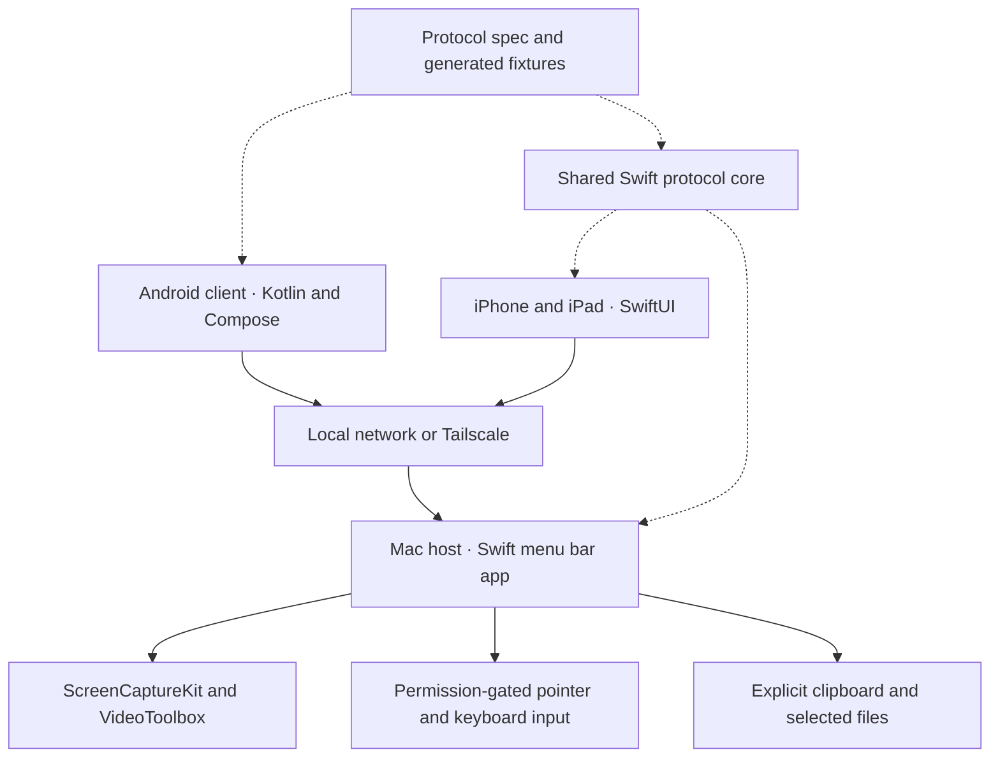

# Architecture

[Documentation home](README.md) · [Development](DEVELOPMENT.md) · [Wire protocol](../protocol/SPEC.md)

Tetherly has one Mac host and two native client implementations. The website is a separate application. The shared contract is the wire protocol and its generated fixtures.

## At a glance

The client controls the Mac's existing desktop. There is no separate virtual desktop, hosted Tetherly account service, or Tetherly relay.

## Source map

| Area | Starting points |
| --- | --- |
| Mac host lifecycle and sessions | [`BridgeHost.swift`](../apps/macos/Tetherly/BridgeHost.swift), [`HostModel.swift`](../apps/macos/Tetherly/HostModel.swift) |
| Mac UI and permissions | [`MenuView.swift`](../apps/macos/Tetherly/MenuView.swift), [`Permissions.swift`](../apps/macos/Tetherly/Permissions.swift) |
| Mac media and input | [`Capture.swift`](../apps/macos/Tetherly/Capture.swift), [`Audio.swift`](../apps/macos/Tetherly/Audio.swift), [`Input.swift`](../apps/macos/Tetherly/Input.swift) |
| Shared Swift contract and trust | [`TetherlyCore`](../apps/macos/TetherlyCore) |
| Android orchestration | [`MainViewModel.kt`](../apps/android/app/src/main/java/link/tetherly/MainViewModel.kt), [`Session.kt`](../apps/android/app/src/main/java/link/tetherly/Session.kt) |
| Android transport and protocol | [`AndroidTransport.kt`](../apps/android/app/src/main/java/link/tetherly/AndroidTransport.kt), [`Protocol.kt`](../apps/android/app/src/main/java/link/tetherly/Protocol.kt) |
| iOS orchestration | [`SessionEngine.swift`](../apps/ios/TetherlyiOS/SessionEngine.swift), [`SessionModel.swift`](../apps/ios/TetherlyiOS/SessionModel.swift) |
| Client interfaces | Android [`SessionScreen.kt`](../apps/android/app/src/main/java/link/tetherly/SessionScreen.kt), iOS [`SessionView.swift`](../apps/ios/TetherlyiOS/SessionView.swift) |
| Website | [`apps/web/src`](../apps/web/src), [`apps/web/README.md`](../apps/web/README.md) |

## Identity before access

Each device has a long-term P-256 identity. The peer's pin is the SHA-256 digest of its certificate's DER SubjectPublicKeyInfo. Pairing uses a custom commitment-based short-authentication-string exchange, tied to the TLS channel and both identities.

An unknown client may enter pairing only while the Mac's pairing window is open. The user compares codes and approves access. A normal session requires an approved, pinned peer. The full state machine and persistence boundaries are in [protocol section 4](../protocol/SPEC.md#4-pairing-inside-a-statepairing-control-connection).

The custom pairing design has not been independently reviewed. See the [security design](SECURITY.md) for the threat model and release gates.

## Separate channels

| Channel | Purpose |
| --- | --- |
| Control | Pairing, session signaling, input, clipboard, and heartbeats |
| Video | H.264 configuration and frames from the Mac |
| Audio | Mac audio sent to the client |
| File | One selected-file transfer |

Connections use TLS 1.3 over TCP on port `47800`. Media and file channels use tickets issued through the authenticated session. Separate channels keep a large media or file payload from being the control channel's framing responsibility.

The frame format is a big-endian 32-bit length, a one-byte type, and a payload. The receiver validates connection-specific size and type limits before allocating or dispatching. Refer to the spec for exact byte formats; do not duplicate those constants in documentation or introduce a second contract.

## Discovery is a route, not trust

The Mac advertises Bonjour service `_tetherly._tcp`. Clients can also connect to a manual address. After pairing, the host reports LAN and Tailscale addresses so clients can retain candidate routes under the same Mac identity.

A new address does not authorize a new key. Reconnection still checks the pinned identity. This distinction matters when a Mac moves networks or a client changes between Wi-Fi and cellular.

## Data and teardown

Screen capture and input require their macOS permissions. Clipboard transfers require explicit send/get actions. File receivers choose destinations; transfers enforce bounds and verify hashes without overwriting an existing destination.

On session termination, hosting disablement, revocation, or permission loss, the design requires cancellation of associated channels and transfers, stopping capture, releasing held input, and discarding queued input. Old input must never replay after reconnect. Use the security and protocol documents when changing these paths.

## Cross-platform changes

A wire change can affect the Mac, Android, iOS, fixtures, and tests together. Update the specification, regenerate fixtures, and exercise every relevant implementation. Source-level and automated evidence should be followed by physical-device acceptance for capture, input, audio, transfers, and network recovery.

The [contribution guide](../CONTRIBUTING.md) describes how to report that evidence in a pull request.
